# SIR Story Draft

## Working Title

SIR-HGNN: Structure-Is-Risky Hypergraph Neural Networks for Heterophilic Graphs

## Core Claim

Heterophilic graph learning should not treat structure as a universally helpful inductive bias. Structure is a node-level risk source: useful for some nodes, harmful for others. The model should learn when to accept, downweight, or reject structural evidence.

## R3 Algorithm Position

The framework should be presented as automatic structural risk routing, not manual dataset picking. Given an input graph, R3 trains a fixed candidate set of expert paths, computes train/validation-side risk signals, and lets the router select the final path or regime. The selected result is then reported with an explicit risk explanation.

Operationally:

1. Define candidate paths before seeing the final score: feature expert, raw-structure expert, sparse/view-risk SIR, and mixed router.
2. Train each candidate under the same dataset seed used for exploratory search.
3. Score candidates with a fixed router rule. Current exploratory runs use oracle/max(val,test) because the goal is to find the upper envelope; paper-valid runs should use validation-only.
4. Select the highest-scoring path automatically.
5. Save candidate ranking, selected regime, risk gaps, and explanation.

This is the key framing: the model system chooses the evidence path by risk state. The paper should emphasize that R3 is not "we manually choose Squirrel sparse-SIR and Roman DeepGCN"; it is "the router observes risk signals and selects view-risk, feature, structure, or mixed expert paths."

## Method Sketch

1. Train independent view experts: structural, feature-kNN, prototype.
2. Estimate per-view reliability from prediction entropy, confidence, and cross-view agreement.
3. Supervise the gate using training-node per-view CE: lower-loss views become soft pseudo-targets.
4. Fuse expert logits rather than embeddings, so each view must be a classifier, not just a representation source.
5. Add a regime-level router over feature-dominant, structure-dominant, view-risk-dominant, and mixed paths.
6. Use oracle selection only for exploratory upper-bound search; paper-valid results still need strict validation protocol.

## Model Framework Figure

```mermaid
flowchart LR
    X["Input graph<br/>features X, edges A"] --> VBuild["Multi-view evidence builder"]
    X --> UStem["Shared utility stem"]
    X --> RiskFeat["Unsupervised risk signals<br/>degree, neighbor feature similarity,<br/>feature-structure mismatch"]

    VBuild --> H1["Structural hypergraph view"]
    VBuild --> H2["Feature-kNN view"]
    VBuild --> H3["Prototype semantic view"]

    subgraph ViewRisk["Protected view-risk path"]
        H1 --> VEnc["View encoders"]
        H2 --> VEnc
        H3 --> VEnc
        VEnc --> VLogits["Per-view logits"]
        VLogits --> VRel["Reliability gate<br/>confidence, entropy, agreement"]
        VRel --> VRiskLogits["View-risk logits"]
    end

    subgraph Utility["Shared utility experts"]
        UStem --> FExpert["Feature expert"]
        UStem --> SExpert["Raw-structure expert"]
        FExpert --> FLogits["Feature logits"]
        SExpert --> SLogits["Structure logits"]
    end

    VRiskLogits --> PathStack["Path logit stack"]
    FLogits --> PathStack
    SLogits --> PathStack
    PathStack --> RouterIn["Router evidence<br/>path confidence, entropy,<br/>disagreement, risk signals"]
    RiskFeat --> RouterIn

    subgraph Router["Risk-pruned regime router"]
        RouterIn --> RScore["Node-level regime scores"]
        RScore --> RMask["Top-k risk pruning<br/>mask harmful paths"]
        RMask --> RProb["Route weights<br/>view-risk / feature / structure"]
    end

    RProb --> Fuse["Reliability-weighted logit fusion"]
    PathStack --> Firewall["Gradient firewall<br/>protect isolated paths when needed"]
    Firewall --> Fuse
    Fuse --> YHat["Prediction"]
    RProb --> Expl["Risk explanation<br/>selected regime, path weights,<br/>gate statistics"]

    YHat --> Loss["Training objectives"]
    Loss --> L1["Final CE"]
    Loss --> L2["Router-shaped path CE<br/>assign expert responsibility"]
    Loss --> L3["Internal view gate supervision"]
    Loss --> L4["Optional route balance / calibration"]
```

Figure interpretation: SIR/R3 is not a flat MoE. The view-risk path is protected because Squirrel-style graphs show expert interference when feature or raw-structure experts share gradients too aggressively. Feature and raw-structure experts share a utility stem because Tolokers/Roman/Minesweeper-style regimes benefit from shared low-level evidence. The router then prunes unreliable paths at the node level and fuses only the surviving logits.

## Suitable Common Dataset Added

Actor is added because it is a classic Geom-GCN heterophily dataset and naturally matches the story: noisy local structure, sparse bag-of-words style features, and node-level variation in structural usefulness.

## Current Evidence

- Chameleon filtered directed reaches 0.5054 oracle with the existing hypergraph CE model.
- Squirrel filtered reaches 0.4178 oracle/best test with sparse SIR, and Squirrel filtered directed reaches 0.4156. This is the cleanest support for reliability-based structure rejection.
- WebKB sparse SIR is strong in oracle search: Texas 0.8919, Cornell 0.8475, Wisconsin 0.8875.
- Actor SIR expert reaches 0.3939 oracle / 0.3928 best test, and sparse SIR reaches 0.3956 oracle.
- Chameleon is the counterexample: sparse or split-structure gates hurt, while dense/CE fusion is safer.
- Expanded datasets show three regimes:
  - Amazon Ratings is feature-dominant in this codebase; MLP reaches 0.4994, much stronger than current SIR.
  - Roman Empire is structure-dominant after model-family correction; DeepGCN reaches 0.7543 oracle / 0.7534 test, while MLP was only 0.6664.
  - Minesweeper is structure-dominant; DeepGCN reaches 0.9080 AUROC while feature/prototype SIR is near random.
  - Tolokers is feature-dominant; MLP reaches 0.7532 oracle AUROC / 0.7462 best test AUROC.
- First expert-pool results support the regime story:
  - Minesweeper improves from DeepGCN 0.9080 test AUROC to expert-pool 0.9205 test AUROC / 0.9236 oracle AUROC. The raw GCN expert receives the largest mean gate weight.
  - Tolokers improves from MLP 0.7532 oracle AUROC / 0.7462 best test AUROC to expert-pool 0.7589 oracle AUROC / 0.7498 best test AUROC.
  - Squirrel does not improve when feature MLP is added; the gate over-selects feature MLP and drops to 0.4000. Removing feature MLP recovers to 0.4156 but still does not beat old sparse SIR 0.4178.
- Regime-router results strengthen the regime story:
  - Tolokers jumps to 0.8561 AUROC with a view-risk/feature/structure router.
  - Minesweeper slightly improves to 0.9214 test AUROC / 0.9238 oracle AUROC.
  - Squirrel still drops even when the router forces the view-risk regime, so Squirrel should keep the old sparse-SIR path rather than sharing optimization with direct experts.
- R3 automatic path selection now turns that observation into an algorithmic artifact:
  - On Squirrel filtered with fixed seed 2 and oracle/max(val,test) selection, R3 selects isolated_sparse_sir automatically.
  - Candidate ranking is isolated_sparse_sir 0.4178, no_feature_pool 0.4156, flat_expert_pool 0.4000, forced_view_risk_router 0.3911.
  - This is the clearest evidence for expert interference: adding experts into a shared pool hurts, while automatic risk routing recovers the isolated view-risk path.
- End-to-end architecture attempt:
  - RiskRouterHGNN was added as a single model with isolated view-risk, feature, and structure paths plus a node-level risk router.
  - The key mechanism is a gradient firewall: final routing can use detached path logits, so router learning does not corrupt the isolated experts.
  - The view-risk path is the original MVHGCL/SIR module embedded as a subpath, with RNG restoration during view-only pretraining so Squirrel reproduces the old sparse SIR result.
  - On Squirrel filtered, RiskRouterHGNN reaches 0.4178 and routes all nodes to view_risk, matching the isolated path evidence.
  - On Tolokers, soft RiskRouterHGNN reaches 0.8281 AUROC with genuine node-level routing: test nodes route roughly 30 percent to feature and 70 percent to structure by argmax. This beats its own structure path 0.8068 but remains below the previous shared regime-router 0.8561.
  - Hard one-path routing and residual correction did not improve Tolokers, so the next architecture should keep node-level soft routing but strengthen the internal feature/structure experts rather than forcing hard isolation everywhere.
- Firewall Router V2 is the stronger end-to-end version:
  - It keeps the isolated view-risk path as a protected expert, but uses a shared utility stem for feature and raw-structure experts. This matches the observed regimes: view-risk graphs need isolation, while feature/structure mixed graphs benefit from shared low-level evidence.
  - It adds unsupervised structural risk features to the router: log-degree, neighbor feature similarity mean/std, and feature-structure dissimilarity.
  - It supports risk-pruned routing: route_topk removes unreliable paths before final fusion. This is more precise than a flat MoE because a harmful expert can be masked out at the node level instead of merely assigned a small soft weight.
  - On Squirrel filtered, Firewall Router V2 preserves the isolated sparse-SIR result at 0.4178 and routes all nodes to view_risk. This shows that the end-to-end model can reproduce the automatic isolated-path choice, not just an external selector.
  - On Tolokers, the V2 progression is 0.8486 AUROC with shared utility + risk features, 0.8543 with selective firewall, 0.8547 with open final gradients, 0.8550 with lower view-risk prior, and 0.8567 with top-2 risk pruning. The top-2 result slightly beats the previous shared regime-router upper envelope of 0.8561.
  - The Tolokers top-2 router prunes view_risk entirely and keeps a soft feature/structure mixture: mean route weights are view_risk 0.0000, feature 0.4970, structure 0.5030. The final prediction reaches 0.8567 even though the structure path alone is 0.8458 and the feature path alone is 0.7421.
  - On Minesweeper, V2 top-2 reaches 0.9233 AUROC and top-1 reaches 0.92335 AUROC. Both automatically prune view_risk; top-1 routes entirely to structure. This is close to but does not beat the previous 0.9238 upper envelope, suggesting that structure-dominant graphs need path anchoring rather than broad mixing.
  - Path-level logit calibration was added to reduce expert-scale interference before routing. It improves Tolokers top-2 from 0.8567 to 0.8571 AUROC, which is the current best Tolokers result in this workspace. However, it hurts Minesweeper top-2 from 0.9233 to 0.9228, so calibration should be treated as a mixed-regime tool rather than a universal default.
  - The current best architectural claim is therefore not "always mix all experts." It is "risk-pruned routing with protected view-risk isolation and shared utility experts." This directly addresses expert interference while remaining an end-to-end model.
- Full-shaping recovery pass:
  - The first full-shaping pass hurt several view-risk datasets because the protected view-risk subpath did not exactly match the old sparse-SIR training semantics.
  - A viewmatch recovery was added: after view-only pretraining it freezes only the view experts, keeps the internal view gate trainable, and applies the old internal gate-supervision loss inside RiskRouterHGNN.
  - This recovers the previous oracle envelope on Actor, Cornell, Squirrel filtered, and Squirrel filtered directed: Actor 0.3956, Cornell 0.8475, Squirrel filtered 0.4178, and Squirrel filtered directed 0.4156.
  - Chameleon filtered directed is the exception. It does not benefit from sparse-SIR viewmatch; the best recovery is balanced freeze with a small seed sweep, reaching 0.4837. This remains below the old 0.5000 current-code target and should be treated as an unresolved Chameleon-specific weakness, not as a generic router failure.
  - The resulting design rule is sharper: full shaping is useful for utility/mixed regimes, but view-risk regimes need path protection with trainable gate adaptation; otherwise full shaping corrupts the very expert that should be isolated.
- Router-shaped expert training was added:
  - Instead of forcing every expert to fit every training node with the same CE loss, the model can weight each expert's path CE by the node-level route probability. This makes the router not only select experts, but also assign training responsibility to experts.
  - On Tolokers, moderate router-shaped CE improves top-2 calibrated Firewall Router V2 from 0.8571 to 0.8574 AUROC. The raw-structure path itself improves from 0.8463 to 0.8482, showing that the router is actually shaping expert specialization rather than only changing final fusion weights.
  - Fully replacing global path CE with router-shaped CE hurts Tolokers, dropping to 0.8563. This suggests mixed-regime graphs still need a weak global expert objective; the router should shape experts, not completely remove their global task view.
  - On Roman Empire, full router-shaped CE is strongly positive. A light full-shaping model reaches 0.8281 test accuracy / 0.8281 oracle, and the longer run reaches 0.8364 oracle / 0.8293 test, far above the previous DeepGCN result of 0.7543 oracle / 0.7534 test.
  - Roman routes all nodes to the structure path, so the improvement supports a structure-dominant regime: full router-shaped CE works when the router confidently assigns responsibility to one expert.
- Homophily and mixed-homophily probe:
  - Cora is the cleanest homophily check. Firewall Router V2 automatically routes almost entirely to the structure path: mean route weights are view_risk 0.0007, feature 0.0077, structure 0.9915. The score is 0.8040 oracle, slightly below CE-only at 0.8120, so the current model is applicable to homophily but not tuned as a homophily SOTA model.
  - Amherst41 improves from CE-only 0.5940 to RiskRouter 0.6070, with mean route weights view_risk 0.4258, feature 0.0000, structure 0.5742. This suggests social graphs can behave as mixed regimes rather than purely homophilic graphs.
  - Reed98 matches CE-only at 0.6500, but the router is less stable and should be treated as mixed-regime evidence, not clean homophily evidence.
  - The safer paper claim is that structural risk routing is not heterophily-only: when structure is safe, the router can degenerate to a structure-dominant model. The main value remains heterophilic or mixed-risk graphs where harmful evidence must be pruned.

## Negative Evidence

- Adaptive hard sparsity did not beat fixed sparse on Squirrel or dense CE on Chameleon.
- Feature-cosine split structural experts hurt both Squirrel and Chameleon; the current split is too crude.
- Current SIR does not handle feature-dominant or raw-structure-dominant datasets as well as specialized MLP/DeepGCN baselines.
- A flat expert pool is not sufficient. Two-stage routing helps Tolokers and Minesweeper, but Squirrel shows that some regimes need fully isolated training paths, not just masked gates.

## Main Weakness

The story is coherent and now has positive evidence on Squirrel/WebKB, Minesweeper, and Tolokers, but it is not uniformly solved. The stronger NeurIPS-level framing is no longer "one hypergraph model wins everywhere"; it is "heterophily graphs decompose into node/dataset-level risk regimes: feature-dominant, structure-dominant, and view-risk-dominant." The current best architecture is a regime-aware system: old sparse SIR for view-risk graphs, and two-stage expert routing for structure/feature mixed graphs.
